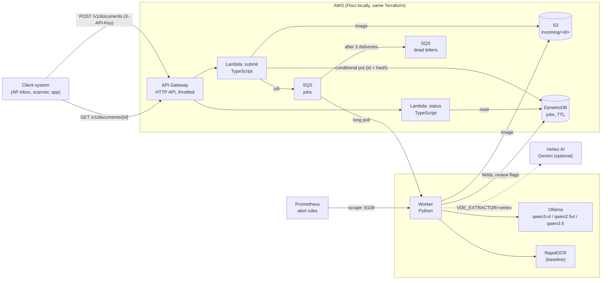

# Architecture

## The two halves

**The intake** is serverless (ADR 0003): it accepts a document, makes it a job and answers at once, and costs
nothing while idle. `submit` validates the API key (SHA-256, constant-time compare), the declared type against the
file's own bytes and the size; the job id is a hash of the kind and the bytes, so the same document twice is one
job. DynamoDB's conditional put is the lock that makes that true under concurrency.

**Extraction** runs where the GPU is. The worker long-polls SQS, reads the image, runs the configured extractor,
attaches review flags (`vde.checks`) and writes the result. SQS does the failure handling: a failed job is offered
again, then dead-lettered after three deliveries; the worker marks it `failed` on the last one.

## The evaluation

Separate from the service, the same extractors run over two public datasets (ADR 0001):

| | CORD v2 (receipts) | FATURA v2 (invoices) |
|---|---|---|
| Documents | real photos, Indonesian | synthetic renders, 50 layouts |
| Test set | the 100-receipt test split | 10 per layout from the 10 held-out layouts |
| Dev set (prompt work, examples) | validation split | the 40 training layouts |
| Metric | Donut field F1, tree-edit accuracy | per-field accuracy after normalising, field F1 |

Every run writes its predictions (JSONL, resumable) and a report with the configuration, the hardware, bootstrap
intervals and the review-flag measurement.

## Where state lives

| What | Where | Kept |
|---|---|---|
| Images | S3 `incoming/<id>.<ext>`, versioned, encrypted | `job_ttl_days` (30), then expired |
| Jobs and results | DynamoDB `vde-jobs` | TTL on `expiresAt` |
| Work in flight | SQS `vde-jobs` (visibility 300 s on AWS) | 4 days |
| Failed work | SQS `vde-jobs-dlq` | 14 days |
| Evaluation | `reports/` in this repository | committed |

## Security, briefly

- No secrets in the repository or in the function environment: the Lambdas hold the API key's SHA-256 only.
- Least-privilege role per function; the worker's permissions are a separate policy.
- The bucket blocks public access and is encrypted (SSE-S3; a customer-managed KMS key is one variable away).
- Logs carry ids, routes, statuses and timings; never document contents or headers.
- gitleaks over history and tree before every push and in CI; pip-audit and npm audit; trivy on the image and the
  Terraform.
